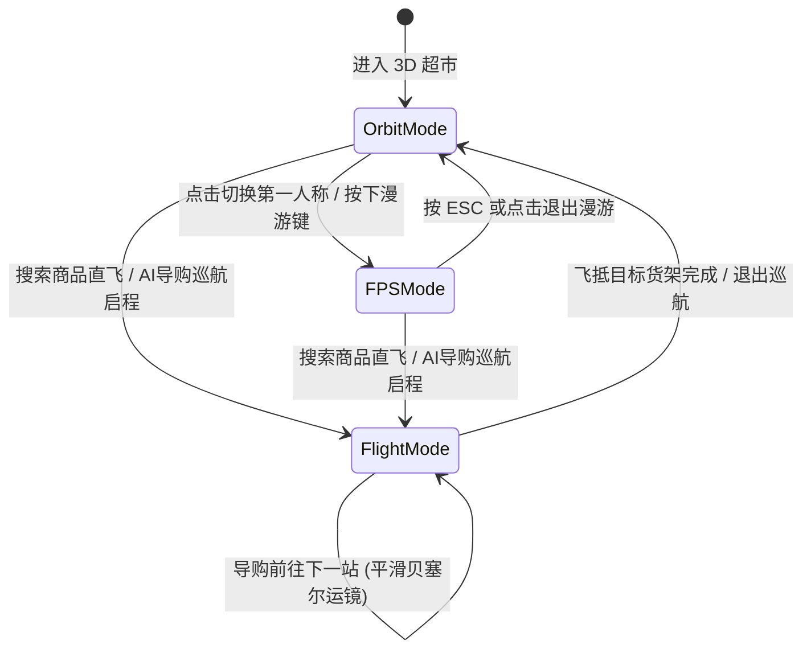

# 3D 数字孪生超市与 AI 导购机器人前端架构与开发设计方案 (design.md)

---

## 一、 系统愿景与设计目标

本项目前端体系旨在为用户打造**媲美原生 3D 游戏的电影级写实购物体验**，并为商户提供**极简高效的中后台运营看板**。

系统分为两个独立打包、轻量解耦的 Web 应用：
1. **3D 购物体验端 (`frontend-supermarket`)**：
   - 沉浸式 3D 数字孪生超市全景（高画质 PBR 物理材质、大理石瓷砖反射、柔和阴影、环境光遮蔽 SSAO 与真实辉光 Bloom）；
   - 三态平滑相机控制（上帝全景 Orbit + 第一人称漫游 FPS + 电影级平滑运镜 Flight）；
   - 空间关键词检索直飞对应货架；
   - 纯 HUD AI 智能导购机器人（自然语言清单解析、空间最近邻动线巡航、逐站运镜、原生 Web Speech 语音播报）；
   - 原生 WebSocket 驱动实时库存变动与货架售罄标红（Emissive 警示红光呼吸灯）；
   - 玻璃拟态商品卡片与极速购物车结算。
2. **商户后台运营端 (`frontend-merchant`)**：
   - 基于 Element Plus 的轻量企业级管理后台；
   - 店内商品管理（CRUD、上下架状态切换、关联货架绑定）；
   - 实时库存快速调控（自动触发全场 3D 客户端 WebSocket 变动与货架售罄判定）；
   - 3D 货架空间点位维护（货架世界坐标、朝向角度、特写巡检相机视点配置）。

---

## 二、 整体技术栈选型与约束

| 维度 | 3D 购物体验端 (`frontend-supermarket`) | 商户后台管理端 (`frontend-merchant`) | 强制约束与说明 |
| :--- | :--- | :--- | :--- |
| **基础框架** | **Vue 3.4+ (SFC, `<script setup>`) + Vite 5.x** | **Vue 3.4+ (SFC, `<script setup>`) + Vite 5.x** | 纯前端工程，现代化构建，热更新秒级响应。 |
| **语言规范** | **TypeScript 5.x** | **TypeScript 5.x** | 严格类型约束，共享后端 DTO/VO 类型定义。 |
| **UI 与样式** | **Tailwind CSS 3.x + Lucide Icons + Glassmorphism** | **Element Plus 2.x + Tailwind CSS** | 客户端采用毛玻璃暗色科技质感；商户端采用清爽后台风格。 |
| **3D 渲染核心** | **Three.js (r160+) + Three-Subdivide / GSAP** | 无（按需轻量 Canvas 示意） | 客户端专享 3D 管线，不污染商户端体积。 |
| **后处理与光影** | **EffectComposer + UnrealBloomPass + SSAOPass** | 无 | 充分利用用户独立 GPU 算力，打造高写实视觉。 |
| **状态管理** | **Pinia 2.x** | **Pinia 2.x** | 集中管理用户状态、购物车、场景对象与实时库存缓存。 |
| **网络与通信** | **Axios + 原生 WebSocket (`/ws/supermarket`)** | **Axios + 原生 WebSocket (`/ws/supermarket`)** | 自动重连机制（心跳检测 + 指数退避重连）。 |
| **语音合成** | **HTML5 Web Speech API (`window.speechSynthesis`)** | 无 | 浏览器原生中文语音朗读，零额外三方 CDN 依赖。 |

---

## 三、 工程组织与目录结构 (微前端双工程架构)

```text
dianshanRag/
├── frontend-supermarket/            # 3D 数字孪生超市与 AI 导购客户端
│   ├── index.html
│   ├── package.json
│   ├── vite.config.ts
│   ├── tsconfig.json
│   ├── tailwind.config.js
│   ├── public/
│   │   ├── textures/                # PBR 贴图资源 (地坪法线/粗糙度、货架木纹/金属)
│   │   └── models/                  # 模块化高精 GLB 资产 (货架、冷柜、典型商品)
│   └── src/
│       ├── main.ts
│       ├── App.vue
│       ├── api/                     # 后端 API 封装
│       │   ├── supermarket.ts       # 场景全景、空间搜索、AI 导购
│       │   ├── order.ts             # 购物车与下单
│       │   └── auth.ts              # 用户登录注册
│       ├── types/                   # TypeScript 类型契约 (对齐后端 VO/DTO)
│       │   ├── scene.ts
│       │   ├── product.ts
│       │   └── guide.ts
│       ├── stores/                  # Pinia 状态
│       │   ├── user.ts
│       │   ├── cart.ts
│       │   ├── scene.ts             # 货架与商品空间数据
│       │   └── websocket.ts         # WebSocket 实时监听与事件派发
│       ├── three/                   # 3D 核心渲染引擎与场景管理
│       │   ├── SupermarketWorld.ts  # 3D 世界根管理器 (Init, Render Loop, Resize)
│       │   ├── SceneBuilder.ts      # 场景生成器 (硬装地坪/吊顶/灯带/PBR材质)
│       │   ├── ShelfManager.ts      # 货架网格加载、点位排布与售罄标红材质切换
│       │   ├── ProductInstancer.ts  # 商品批量实例化渲染 (InstancedMesh)
│       │   ├── CameraController.ts  # 三态相机切换 (Orbit / FPS Roaming / GSAP Flight)
│       │   ├── PostProcessing.ts    # 后处理管线 (Bloom 泛光 / SSAO 环境遮蔽)
│       │   └── InteractionManager.ts# 空间射线拾取、Hover 高亮与点击事件
│       └── components/              # 2D UI 悬浮 HUD 组件
│           ├── Navbar.vue           # 顶部搜索栏、画质切换、购物车徽章、登录态
│           ├── RoamingControlHelp.vue # 第一人称漫游键位提示 (WASD / 视角锁定)
│           ├── ProductCardDrawer.vue  # 侧边/底部毛玻璃商品卡片 (详情与即时加购)
│           ├── CartDrawer.vue       # 购物车抽屉与一键结算
│           ├── AiGuideModal.vue     # AI 导购清单输入弹窗
│           ├── AiGuideCruiseBar.vue # 底部 AI 导购巡航控制条 (步进/暂停/解说词)
│           └── ShelfLabel2D.vue     # CSS2D 货架顶端名称与售罄红标
│
└── frontend-merchant/               # 商家中后台管理系统
    ├── index.html
    ├── package.json
    ├── vite.config.ts
    ├── src/
    │   ├── main.ts
    │   ├── App.vue
    │   ├── router/                  # 页面路由
    │   │   └── index.ts             # /products (商品管理), /shelves (货架点位)
    │   ├── api/                     # 商家后台接口封装
    │   │   └── merchant.ts
    │   ├── stores/                  # 商家状态与 WebSocket 实时刷新
    │   └── views/
    │       ├── ProductManageView.vue # 商品 CRUD、上下架、行内实时库存调整
    │       └── ShelfManageView.vue   # 货架 3D 空间坐标、朝向与相机视点维护
```

---

## 四、 3D 写实建模与渲染管线方案 (Realism Pipeline)

### 1. 建筑硬装与 PBR 材质生成规范
- **地坪系统**：
  - 尺寸与几何体：`PlaneGeometry(50, 40)`；
  - 材质：`MeshPhysicalMaterial`；
  - 参数：`roughness: 0.15`, `metalness: 0.05`, `reflectivity: 0.6`, `clearcoat: 0.8`, `clearcoatRoughness: 0.1`；
  - 贴图：加载无缝大理石砖纹理，并注入法线贴图（`normalMap`）以产生瓷砖砖缝立体下沉与表面微妙微反射。
- **照明与环境反射**：
  - **环境反射**：使用 `PMREMGenerator` 加载室内商业照明 HDR 全景贴图作为场景环境图（`scene.environment`），赋予金属货架与玻璃高光反射；
  - **主灯光**：顶层矩阵布局柔和点光源（`PointLight`）与漫射环境光（`AmbientLight`），开启 `castShadow`；
  - **阴影设置**：采用 `PCFSoftShadowMap`，阴影图分辨率设定为 2048x2048，柔化边缘。
- **冷柜玻璃与通透材质**：
  - 采用 `MeshPhysicalMaterial`，开启 `transmission: 0.9`，`opacity: 1.0`，`transparent: true`，`ior: 1.5`（真实玻璃折射率）。

### 2. 后处理特效管线 (Post-Processing)
采用 `three/addons/postprocessing/EffectComposer.js`：
1. **RenderPass**：基础三维场景渲染通道；
2. **SSAOPass (屏幕空间环境光遮蔽)**：
   - 赋予货架底座与地面交界处、排布密集的商品缝隙自然的黑色环境阴影褶皱，彻底消除 3D 物体悬浮感；
3. **UnrealBloomPass (选择性柔和泛光)**：
   - 参数：`threshold: 0.85`, `strength: 0.4`, `radius: 0.5`；
   - 视觉效果：让超市天花板的 LED 条形灯带、发光吊牌、以及**售罄货架的红色呼吸警示光**产生梦幻写实的光晕溢出感；
4. **OutputPass (色彩管理与色调映射)**：
   - 启用 `renderer.toneMapping = THREE.ACESFilmicToneMapping`，`toneMappingExposure = 1.1`，呈现电影级色彩动态对比。

### 3. 货架网格与售罄材质动态切换
- 货架常态材质：铝合金哑光白/深灰（`roughness: 0.4`, `metalness: 0.8`）；
- 售罄警示状态 (`status: "OUT_OF_STOCK"`)：
  - 货架边框灯带材质置换为警示红：`emissive: 0xff0033`, `emissiveIntensity: 1.5`；
  - 在帧循环中通过 `Math.sin(clock.getElapsedTime() * 3)` 驱动红光呼吸闪烁；
  - 货架上方挂载的 `CSS2DObject` 显示亮红色的 **[已售罄 ⚠️]** 徽章；
  - 补货恢复为 `NORMAL` 后，红光淡出，恢复常规金属发光。

---

## 五、 三态相机交互与运镜引擎设计 (CameraController)



1. **上帝全景模式 (OrbitControls)**：
   - 初始机位：`camera.position.set(0, 3.0, 8.0)`，`target.set(0, 1.0, 0)`；
   - 限制俯仰角与缩放区间：`minDistance: 3`, `maxDistance: 35`, `maxPolarAngle: Math.PI / 2 - 0.05`（防止穿透地下）。
2. **第一人称漫游模式 (FPS Roaming)**：
   - 视点高度固定为成人平视高度：`Y = 1.6m`；
   - 键位操作：`W / A / S / D` 控制前后左右位移，`Shift` 加速奔跑；
   - 视线旋转：鼠标指针锁定（`PointerLockControls`）或按住鼠标右键平滑旋转；
   - 防穿墙机制：向移动前方发射 4 条微量水平射线（Raycaster），当距货架碰撞体小于 0.6m 时停止向前位移。
3. **电影级飞掠运镜模式 (Flight Mode - GSAP / TWEEN)**：
   - 飞跃至货架特写机位：根据后端返回的 `cameraTargetX/Y/Z` 与 `positionX/Y/Z`；
   - 运动曲线：使用 `Cubic.easeInOut` 平滑插值相机的 `position` 与 `controls.target`；
   - 飞行耗时：约 1.2s - 1.8s；飞抵瞬间触发该货架所属商品卡片滑出，并对该商品模型施加 OutlinePass 高亮发光。

---

## 六、 AI 导购机器人纯 HUD 视觉与语音交互规范

### 1. 交互流程设计
1. **唤起清单录入**：
   - 用户在顶部常驻搜索栏点击“🤖 AI 智能导购”或按下快捷键 `G`，弹出玻璃拟态清单对话框；
   - 支持快捷输入预设样例（如：“我想买一箱牛奶，一台笔记本电脑，还要一副降噪耳机”）。
2. **请求路径规划**：
   - 提交调用后端接口：`POST /api/supermarket/guide/route`；
   - 成功获取 `GuideRouteResponseVO`（包含 `summary`、`totalStops`、`waypoints` 数组与 `unmatchedItems`）。
3. **巡航启动与底部控制条展开**：
   - 屏幕底部滑出 **AI 导购巡航控制条 (`AiGuideCruiseBar.vue`)**；
   - 右上角浮现 AI 虚拟形象气泡，播放第一段开场白文本，并通过原生 Web Speech API 朗读声音；
   - 相机自动平滑启程，飞向第 1 站货架。
4. **逐站特写与自动解说**：
   - 到达站点时：
     - 相机悬停在货架特写机位（`cameraTarget`）；
     - 货架商品轮廓发光；
     - 右侧/底部展示该商品毛玻璃卡片（带加购与数量）；
     - 语音朗读该站专属讲解词（`waypoint.guideSpeech`）；
   - 用户可点击“加购商品”、“暂停”、“上一站”、“下一站”或“退出巡航”。

### 2. 原生 Web Speech 语音播报封装
```typescript
class GuideVoiceSynthesizer {
  private synth = window.speechSynthesis;

  speak(text: string, onEnd?: () => void) {
    if (!this.synth) return;
    this.synth.cancel(); // 停止当前未播完的语音

    const utterance = new SpeechSynthesisUtterance(text);
    utterance.lang = 'zh-CN';
    utterance.rate = 1.05; // 稍快轻快的语速
    utterance.pitch = 1.0;

    // 优先选择自然亲和的中文普通话声音
    const voices = this.synth.getVoices();
    const zhVoice = voices.find(v => v.lang.includes('zh') || v.lang.includes('cmn'));
    if (zhVoice) utterance.voice = zhVoice;

    if (onEnd) utterance.onend = onEnd;
    this.synth.speak(utterance);
  }

  stop() {
    this.synth?.cancel();
  }
}
```

---

## 七、 WebSocket 实时数据流与售罄响应机制

### 1. 客户端连接与重连机制
- 连接地址：`ws://localhost:8080/ws/supermarket`；
- 状态机：连接中（Connecting）、在线（Connected）、断开重连（Reconnecting）；
- 心跳：每隔 30 秒发送 Ping 报文，断线后以 1s、2s、5s、10s 指数退避自动重试。

### 2. 报文响应与 3D/2D 联动
收到广播报文：
```json
{
  "event": "INVENTORY_CHANGED",
  "productId": 2,
  "productName": "Sony WH-1000XM5 无线降噪头戴耳机",
  "stock": 0,
  "isOutOfStock": true,
  "shelfId": 2,
  "shelfCode": "B01",
  "shelfStatus": "OUT_OF_STOCK",
  "timestamp": 1794286720273
}
```
前端联动逻辑：
1. **Pinia Store 更新**：
   - `sceneStore.updateProductStock(data.productId, data.stock)`;
   - `sceneStore.updateShelfStatus(data.shelfId, data.shelfStatus)`.
2. **3D 材质联动**：
   - 若 `shelfStatus === 'OUT_OF_STOCK'`：调用 `ShelfManager.markShelfOutOfStock(shelfId)`，开启红色泛光呼吸材质；
   - 若 `shelfStatus === 'NORMAL'`：调用 `ShelfManager.restoreShelfNormal(shelfId)`，恢复常规金属材质。
3. **2D HUD 联动**：
   - 若当前打开的商品卡片正是变动商品，实时更新库存数字并控制“加入购物车”按钮状态；
   - 屏幕右上角弹窗 Toast 提示：“商品 [Sony WH-1000XM5] 实时库存变动：当前剩余 0 件”。

---

## 八、 商户后台管理端设计规范 (`frontend-merchant`)

### 1. 页面构成与核心功能
1. **商品管理页 (`/products`)**：
   - **列表与分页**：调用 `GET /api/merchant/products`，展示商品图片、名称、品类、售价、实时库存、上下架状态（Tag 绿/灰）、所在货架编码（如 `A01`）；
   - **上下架开关**：`el-switch` 快速切换，调用 `PUT /api/merchant/products/{id}/status?status=...`；
   - **行内快捷改库存**：点击库存单元格即时变成输入框，回车或失焦直接调用 `PUT /api/merchant/products/{id}/stock?stock=...`；修改后不仅当前行更新，还会通过 WebSocket 即时同步给所有 3D 用户客户端；
   - **新建/编辑对话框**：录入商品名称、价格、库存、选择绑定的 3D 货架下拉列表。
2. **3D 货架空间点位维护页 (`/shelves`)**：
   - 列表展示全场货架编码、货架名称、分区、3D 空间坐标（`X, Y, Z`）、旋转角度（`rotY`）、特写相机注视点（`cameraTargetX, Y, Z`）与当前状态（正常/售罄）；
   - 提供可视化点位调整表单：商户可微调货架点位或创建新货架，保存后 3D 端刷新即可动态加载新货架。

---

## 九、 实施计划与里程碑 (Milestones)

- [ ] **Milestone 1：基础脚手架初始化**
  - 创建 `frontend-supermarket` 与 `frontend-merchant` 两个独立 Vite + Vue 3 工程；
  - 配置 TypeScript、Tailwind CSS、Element Plus 与 Pinia。
- [ ] **Milestone 2：3D 核心世界与 PBR 渲染管线搭建**
  - 构建 `SupermarketWorld.ts`、大理石瓷砖地坪、吊顶灯阵、环境 HDR 贴图；
  - 集成 EffectComposer、UnrealBloomPass 与 SSAOPass。
- [ ] **Milestone 3：后端接口对接与货架/商品动态陈列**
  - 对接 `GET /api/supermarket/scene`，动态摆放 7 个货架与代表性商品网格；
  - 挂载 CSS2D 货架顶端标牌。
- [ ] **Milestone 4：三态相机与交互拾取**
  - 实现 Orbit 全景模式与第一人称 WASD 漫游模式平滑切换；
  - 实现射线拾取、鼠标悬停轮廓发光高亮（OutlinePass）；
  - 实现右侧/底部毛玻璃商品详情卡片与加购购物车流程。
- [ ] **Milestone 5：AI 导购机器人巡航与语音播报**
  - 封装清单输入对话框，对接 `POST /api/supermarket/guide/route`；
  - 实现 GSAP 贝塞尔相机逐站飞掠与底部巡航控制条；
  - 集成 Web Speech API 中文解说词朗读。
- [ ] **Milestone 6：WebSocket 实时联动与售罄呼吸灯**
  - 接入 `ws://localhost:8080/ws/supermarket`；
  - 实时更新库存，售罄时货架边框灯带呼吸红光与标红。
- [ ] **Milestone 7：商户端后台构建与联调**
  - 搭建 `frontend-merchant` 界面，实现商品 CRUD、上下架与快捷库存变更；
  - 双端联调测试：商户改库存 -> 3D 端毫秒级红光告警响应。

---

## 十、 验收指标

1. **真实感与视觉还原**：具备地面法线微反射、柔和阴影、角落环境遮蔽（SSAO）与灯带柔和泛光（Bloom），无悬浮感与塑料感。
2. **性能与帧率**：在独立 GPU 环境下稳定 60 FPS，Draw Call 控制在 80 以内，首屏静态资产加载在 10MB 以内。
3. **实时性与联动**：商户后台改库存或用户并发下单后，3D 超市客户端 100ms 内收到 WebSocket 推送，售罄货架即时标红。
4. **导购流畅度**：自然语言清单解析准确率高，运镜动线无顿挫和瞬移，语音播报与站点到达高度同步。
