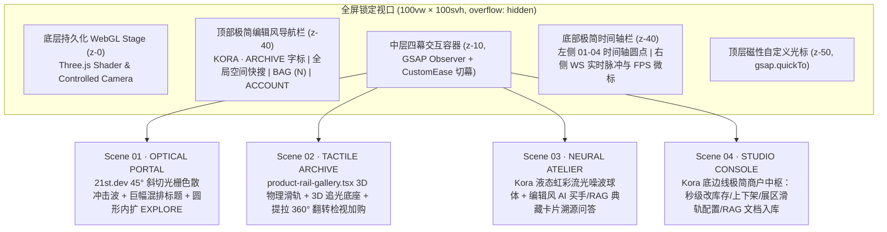

# KORA × TACTILE ARCHIVE — 3D 触感物理陈列与光栅先锋旗舰店重构设计规范

- **日期**：2026-11-16
- **状态**：Draft (Pending Builder Check & User Approval)
- **关联 Skills**：`gsap-core`, `gsap-react`, `gsap-timeline`, `gsap-scrolltrigger`, `gsap-plugins`, `gsap-performance`, `gsap-utils`, `gsap-frameworks`
- **视觉与交互对标**：
  1. [21st.dev DesignAli Shader Animation](https://cdn.21st.dev/designali-in/shader-animation/default/bundle.1755486352920.html) — 45° 斜切百叶窗色散光学冲击波 WebGL Fragment Shader + 纯黑曜石背景 + 高冲击紧缩字距主标题。
  2. [Kora — Independent Creative Agency](https://kora-3d-agency.vercel.app/) — 四幕式先锋 3D 空间剧场、受控黄金构图机位、高定编辑部字体混排（粗体无衬线 + 经典斜体衬线 + 宽字距技术微标）、圆形内扩填充磁吸按钮、液态虹彩流光噪波球体、极简底边线表单与时间轴圆点导航。
  3. **21st.dev `product-rail-gallery.tsx` (`ClothingRailHero`)** — 3D 触感物理衣架滑轨、指针划过拨动摇摆与碰撞挤压物理模拟、吊牌独立摆动、提拉脱离滑轨进入 `perspective: 1400px` 3D 正反面 360° 拖拽检视台。

---

## 一、 设计意图与背景 (Intent & Why)

现有前端（`frontend-supermarket` 与 `frontend-merchant`）采用的传统毛玻璃（Glassmorphism）面板、具象超市货架盒子以及底部移动导购巡航条视觉廉价且交互繁琐，不再符合产品定位。

本次重构**彻底推倒并废弃现有全部前端界面与旧 3D 超市代码（Zero Legacy Reference）**，从零构建一个统一的 **Vite + React + TypeScript + Tailwind CSS + shadcn 目录规范（`/src/components/ui`）** 先锋数字旗舰店应用。新系统不再模拟传统超市货架与移动导购机器人巡航，而是将全部重心放在**极致的物品展示、触感物理反馈与 3D 空间把玩体验**上，同时无缝承接后端 Spring Boot 已有的电商交易（购物车、Redisson 防超卖下单）、WebSocket 实时库存广播、RAG 知识库精准溯源问答与商户商品/库存调控接口。

---

## 二、 目标、非目标与反目标 (Goals, Non-Goals & Anti-Goals)

### 1. 核心目标 (Goals)
- **G1 · 三大专属 3D 触感物品把玩展厅（服饰悬架厅 + 旗舰数码长桌厅 + 博物馆玻璃展柜厅）**：
  1. **Scene 02 · `GARMENT RAIL`（高定服饰悬架厅，`/src/components/ui/product-rail-gallery.tsx`）**：指针划过金属滑轨时的弹簧阻尼碰撞、衣架摆动、吊牌摇晃；点击藏品时以 3D 提拉动画飞入中央检视舞台，支持拖拽 360° 正反面翻转检视与一键加购。
  2. **Scene 03 · `HORIZON TECH TABLE`（旗舰数码极简体验长桌厅，`/src/components/ui/tech-table-gallery.tsx`）**：
     - **专属入场动效**：3D 透视阳极氧化铝/黑曜石桌面浮现并扫过一道电光青 `#00F0FF` 水平激光扫描线，桌面上的 6 款旗舰数码产品（智能手机、空间降噪头戴耳机、超薄算力笔电、钛金属智能腕表、便携 Hi-Fi 解码耳放、全画幅微单机身）依次从休眠态弹簧升起就位并点亮屏幕呼吸光。
     - **桌面掠过动效**：指针在桌面上横向滑过时，设备触发弹簧磁吸悬浮抬升（Magnetic Levitation）、屏幕唤醒高亮（Screen Wake-up Glow）、3D 倾角跟随与桌面底部实时倒影。
     - **点击提拉与 3D 检视专属动效**：点击任意数码单品时，桌面磁吸环爆发脉冲，设备从斜置底座垂直弹起并修正倾角飞入 `perspective: 1400px` 3D 检视舞台；检视台支持 **360° 拖拽旋转** 以及 **三大专属交互态切换**：`DISPLAY WAKE`（正面动态 OLED 屏幕点亮）、`OPTICS / BACK`（180° 翻转查看背部镜头模组与钛金属工艺）、`X-RAY EXPLODED`（Z 轴多层全息悬浮拆解视图，展示屏幕层、核心芯片发光层与背板层）；关闭时设备飞回桌面原磁吸位并激起桌面光圈涟漪。
  3. **Scene 04 · `VITRINE GALLERY`（精品器物博物馆玻璃展柜厅，`/src/components/ui/vitrine-pedestal-gallery.tsx`）**：
     - **专属入场动效**：顶部锥形聚光灯束依次点亮，黑曜石大理石展柱自下而上升起，高透折射玻璃防尘钟罩（Vitrine Glass Bell Hoods）从高处带阻尼弹簧缓冲垂直落下罩住展品（高定沙龙香氛、陀飞轮机械腕表、Kora 联名潮玩雕塑、钛金属手冲壶、声学水晶球、典藏黑胶唱机）。
     - **展柜掠过动效**：指针靠近某座展柜时，该展柜的**透明玻璃钟罩以二阶弹簧物理向上缓缓升起（Glass Bell Lift）**，内部器物在聚光灯下悬浮微转并投射折射高光。
     - **点击提拉与 3D 检视专属动效**：点击展柜时，**玻璃钟罩先快速向上完全升空退场（Unseal Glass Bell）**，器物从展柱底座旋转托举飞入中央 **3D 精密刻度旋转展盘（360° Turntable Stage）**；支持拖拽 360° 旋转折射扫光，并提供 **`OBVERSE`（正面主视）**、**`INSCRIPTION`（背面工艺铭文）** 与 **`TURNTABLE AUTO-SPIN`（博物馆恒速环绕自转鉴赏）** 三种检视模式；关闭时器物落回展柱，玻璃钟罩随之从上方缓降闭合锁死。
- **G2 · Kora × 21st.dev 六幕式受控电影机位空间剧场**：通过全局单实例持久化 Three.js WebGL 画布与 `GSAP Observer` + `CustomEase` 状态机，在六幕（`01 OPTICAL PORTAL` → `02 GARMENT RAIL` → `03 TECH TABLE` → `04 VITRINE GALLERY` → `05 NEURAL ATELIER` → `06 STUDIO CONSOLE`）之间实现戏剧性的背景 Shader 与 3D 灯光插值过渡，同时三大展厅（02/03/04）顶部提供快捷空间切换栏。
- **G3 · 全量落地 8 个官方 GSAP Skills 最佳实践**：
  - `gsap-react`：全站统一使用 `@gsap/react` 的 `useGSAP()` 钩子、`scope` 容器限定与 `contextSafe()` 事件包装，杜绝组件卸载内存泄漏。
  - `gsap-core` & `gsap-timeline`：使用 `gsap.timeline({ defaults })` 编排入场与切幕序列，优先使用 `autoAlpha` 与变换别名（`x`, `y`, `scale`, `rotation`），并通过 `gsap.matchMedia()` 适配响应式断点与 `prefers-reduced-motion: reduce`。
  - `gsap-performance`：使用 `gsap.quickTo()` 驱动 60fps 零布局抖动的磁性自定义光标（Magnetic Cursor）、鼠标微视差与第 02 幕 3D 聚光灯实时追光。
  - `gsap-plugins`：在应用入口一次性 `gsap.registerPlugin(useGSAP, Observer, Flip, SplitText, ScrambleTextPlugin, CustomEase)`；使用 `SplitText` 实现高定编辑风标题遮罩切分入场，`ScrambleTextPlugin` 实现价格/库存/坐标/相似度数字解码跳动，`Flip` 实现购物袋与系列切换器布局形变。
  - `gsap-utils`：使用函数柯里化形态的 `clamp`、`mapRange`、`normalize`、`interpolate` 与 `pipe` 处理指针归一化坐标与 Shader Uniform 映射。
- **G4 · 前后端真实数据与实时流闭环**：将 `ClothingRailHero` 的藏品滑轨与后端商品接口（`/api/supermarket/scene`、`/api/merchant/products`）及高定示范系列（`RAIL_DEMO_ITEMS`）双源打通；WebSocket（`/ws/supermarket`）收到库存变动或售罄事件时，滑轨吊牌与检视台实时通过 `ScrambleTextPlugin` 刷新库存并切换售罄警示状态。

### 2. 非目标 (Non-Goals)
- **NG1**：不修改后端 Java / Spring Boot 业务代码或数据库表结构，完全复用现有 REST API 与 WebSocket 端点。
- **NG2**：不再保留第一人称 WASD 走动漫游、超市走道碰撞检测、自动导购小车路线巡航条或 Web Speech 语音朗读。

### 3. 反目标 / 严令禁止项 (Anti-Goals)
- **AG1 · 严禁沿用任何旧前端毛玻璃 UI（No Legacy Glassmorphism）**：禁止出现旧版的 `bg-slate-900/85 backdrop-blur-2xl rounded-3xl border-cyan-500` 科技蓝毛玻璃卡片、普通后台白底表格或 Element Plus 默认外观。
- **AG2 · 严禁粗糙的具象超市货架盒子**：禁止在 3D 画布中堆砌廉价的立方体货架或商品方块。
- **AG3 · 严禁失控的自由旋转机位**：相机与构图严格受控（Kora 模式），确保每一帧都具备独立创意机构（Kora）的杂志级排版构图。

---

## 三、 技术与工程约束 (Constraints)

1. **工程结构替换**：
   - 将新前端直接构建为统一的 Vite + React 18 + TypeScript 5 + Tailwind CSS 3 工程（支持 `@/` 路径别名与 shadcn 标准目录 `/src/components/ui`）。
   - 核心物理滑轨组件必须存放在 `/src/components/ui/product-rail-gallery.tsx`。
   - 开发服务器端口配置为 `5173`，Vite Proxy 代理 `/api` 至 `http://localhost:8080`、`/ws` 至 `ws://localhost:8080`。
2. **色彩与字体系统（Kora × DesignAli 色板）**：
   - **基底色**：纯黑曜石 `#000000`（`--background: 0 0% 0%`）、深空暗紫黑 `#0D0C12`、高对比纯白 `#FFFFFF`（`--foreground: 0 0% 100%`）。
   - **品牌点缀色**：Kora 薰衣草紫 `#C8C3F2`（悬停亮化 `#DDD9FB`）、薄荷青绿 `#A8E6CF`、赛博荧光绿 `#00FF66`、光栅冲击波电光青 `#00F0FF` 与琥珀金 `#FFA500`、售罄警示绯红 `#FF2A54`。
   - **字体排印（Editorial Dual-Type System）**：
     - 标题无衬线：`Inter` / `Syne` / 系统紧缩几何无衬线（`tracking-tighter`, `leading-none`, `font-semibold`）；
     - 强调斜体衬线：`Instrument Serif` / `Playfair Display` / `Georgia` 斜体（用于标题中的点睛词，如 *"Something *rare.*"*、*"Tactile *archive.*"*）；
     - 技术微标与数据读数：`JetBrains Mono` / `Jura` 等宽/技术字体，大写宽字距（`uppercase tracking-[0.28em] text-[11px]`）。

---

## 四、 架构方案评估与选型决策 (Approaches)

在设计阶段共评估了三种底层架构方案，并由用户最终拍板选定 **方案 A**：

| 方案 | 架构描述 | 核心优势 | 核心取舍 | 决策 |
| :--- | :--- | :--- | :--- | :--- |
| **方案 A（已选定）** | **全局单实例持久化 WebGL 画布 + GSAP Observer 四幕状态机 + 第 02 幕 3D 聚光灯实时追光物理滑轨** | 1. 全局仅 1 个 Three.js WebGL 上下文，切幕时 Shader Uniform 与受控机位通过 `CustomEase` 丝滑插值，零上下文重建开销；<br>2. 第 02 幕底层的 3D 聚光灯与透视网格能通过 `gsap.quickTo` 实时追踪上方 `ClothingRailHero` 当前拨动/激活衣架的水平坐标，实现 3D 光影与物理衣架的跨层咬合。 | 需要设计统一的 WebGL Stage Controller 管理四幕 Shader 与光照权重。 | **✅ 用户选定** |
| **方案 B** | 分幕独立挂载 WebGL Canvas 组件 + GSAP 交叉淡入淡出 | 各幕组件文件相对独立。 | 切幕时频繁销毁/创建 WebGL 上下文易掉帧，且缺少 Kora 标志性的跨幕连续空间镜头推进感。 | ❌ 放弃 |
| **方案 C** | 原生纵向滚动长卷（`ScrollTrigger` + `pin: true` + `scrub: 1`） | 符合传统长网页浏览习惯。 | 纵向滚动惯性容易与第 02 幕 `ClothingRailHero` 的横向指针拨动及 3D 拖拽翻转产生手势冲突。 | ❌ 放弃 |

---

## 五、 详细系统设计（按已确认方案展开）

### 1. 全局框架与四幕状态机 (Global Stage & Chrome)



- **切幕控制逻辑**：
  - 使用 `Observer.create({ target: window, type: "wheel,touch", tolerance: 45 })` 监听滚轮与触摸滑动（当第 02 幕 `Detail` 3D 检视弹窗打开、购物袋抽屉打开、或指针位于第 03/04 幕内部可滚动列表区域时，自动放行内部滚动，不误触切幕）。
  - 每次切幕锁定时长 `1.1s`，使用 `CustomEase.create("koraEase", "0.74, -0.02, 0.94, -0.32")` 或 `"power4.inOut"` 同步驱动：
    1. 底层 WebGL 画布的 4 组场景权重（`uSceneWeights`）与受控相机位置/注视点平滑插值；
    2. 当前幕 DOM 容器的 `autoAlpha`、`yPercent` 与 `SplitText` 标题遮罩入场；
    3. 底部左侧 4 枚 Kora 时间轴圆点（`01 PORTAL`, `02 ARCHIVE`, `03 ORACLE`, `04 ATELIER`）的缩放（默认 `scale: 0.35`，悬停 `scale: 0.6`，激活 `scale: 1` 配薰衣草紫光环 `#C8C3F2`）。

---

### 2. 分幕视觉与交互详设

#### Scene 01 · `OPTICAL PORTAL`（光栅冲击波序幕）
- **底层 WebGL 效果（1:1 复刻 21st.dev DesignAli Shader Animation）**：
  - 使用 Three.js 全屏平面 Shader，核心 GLSL Fragment Shader 数学公式如下（通过 `mod(uv.x + uv.y, 0.2)` 产生 45° 斜切百叶窗光栅遮罩，通过 `fract(t - 0.01 * float(j) + float(i) * 0.01) * 5.0 - length(uv)` 产生 RGB 三通道色散向外扩散的周期性冲击波，并乘以场景权重 `uScene1Weight`）：
    ```glsl
    precision highp float;
    uniform vec2 uResolution;
    uniform float uTime;
    uniform float uScene1Weight;

    void main(void) {
      vec2 uv = (gl_FragCoord.xy * 2.0 - uResolution.xy) / min(uResolution.x, uResolution.y);
      float t = uTime * 0.05;
      float lineWidth = 0.002;

      vec3 color = vec3(0.0);
      for (int j = 0; j < 3; j++) {
        for (int i = 0; i < 5; i++) {
          color[j] += lineWidth * float(i * i) / abs(
            fract(t - 0.01 * float(j) + float(i) * 0.01) * 5.0 - length(uv) + mod(uv.x + uv.y, 0.2)
          );
        }
      }
      gl_FragColor = vec4(color * uScene1Weight, 1.0);
    }
    ```
- **前景编辑风排版与交互**：
  - 中央卡片容器（`rounded-2xl border border-white/10`）或全幅取景框，顶部显示宽字距技术眉标 `EDITION 2026 · SPATIAL TACTILE COMMERCE`；
  - 巨幅主标题采用粗体无衬线与斜体衬线混排：`CURATED OBJECTS, *TACTILE* REALITY.`（`text-6xl sm:text-8xl tracking-tighter leading-none`），由 `SplitText`（`mask: "lines"`）在首屏加载完成时逐行弹性揭示；
  - 下方居中放置 **Kora 标志性圆形探索触发器（`EXPLORE ARCHIVE`）**：直径 `112px` 的细线圆环，鼠标移入时触发 `gsap.quickTo` 磁吸位移，且内部黑色/薰衣草紫填充圆从 `scale(0)` 放大至 `scale(2.1)`，文字反相变色，点击直接切入 **Scene 02 · TACTILE ARCHIVE**。

#### Scene 02 · `TACTILE ARCHIVE`（纯物理滑轨 3D 旗舰展厅）
- **核心组件集成（`/src/components/ui/product-rail-gallery.tsx`）**：
  - 用户提供的完整原始组件代码与 `RAIL_DEMO_ITEMS`（含全部 6 类 SVG 服饰矢量路径 `ART`、`Defs`、`Hanger`、`Fabric`、`SideArt`、二阶弹簧阻尼物理循环 `step`、提拉详情弹窗 `Detail` 及 10 件 21st.dev WebP 三视图数据）已完整归档于参考源码文件：[product-rail-gallery.reference.tsx](file:///e:/XiangMu/dianshanRag/docs/superpowers/specs/references/product-rail-gallery.reference.tsx)。
  - 实现时直接将该参考源码落地至 `/src/components/ui/product-rail-gallery.tsx`，保留其全部精妙的物理细节：
    - 金属拉丝横杆（Brushed Chrome Rail）与两侧固定托架；
    - 指针划过（Brush along the rail）或拖拽衣架时的二阶弹簧阻尼物理引擎（`stiff: 130`、相邻衣架碰撞体积排斥 `footprint`、摆角 `swing` 惯性、布料垂感倾斜 `--drape`、吊牌独立角速度摇摆 `tag` 以及基于角度的 Lambert 漫反射明暗 `--shade`）；
    - 点击任意单品时，触发原位提拉升空动画（Lift & FLIP），进入全屏 `perspective: 1400px` 3D 检视舞台（`Detail`），支持鼠标左右拖拽旋转查看 **正面（Front）/ 背面（Back）**，关闭时精准飞回滑轨原挂钩位置并赋予相邻衣架物理冲量（`impulse`）。
  - 同时为 `RailGarment` 与 `ClothingRailHeroProps` 扩展可选电商插槽（如 `productId?: number`、`price?: number`、`stock?: number`、`outOfStock?: boolean`、`onAddToBag?: (item: RailGarment, quantity: number) => void` 或 `renderDetailFooter?: (item: RailGarment) => React.ReactNode`），以便在 `Detail` 3D 检视台内无缝渲染实时库存与一键加购控件。
- **Kora 3D 追光底座与电商业务融合增强**：
  1. **底层 WebGL 追光联动**：当用户在滑轨上划过或聚焦某件单品时，将当前激活单品的归一化横坐标与主题色（`item.color`）实时传给底层 Three.js 舞台，由 `gsap.quickTo` 驱动 3D 空间中的 **聚光灯锥（Volumetric Spotlight）与地面镜面湿地反射光斑（Wet-Floor Reflection）** 实时跟随该件展品移动。
  2. **展区 / 系列切换器（Collection Switcher）**：
     - 在滑轨上方提供极简 Kora 编辑风系列切换标签：
       - `COLLECTION 01 · ATELIER GARMENTS`（默认加载 `RAIL_DEMO_ITEMS` 的 10 件高定正反侧三视图服饰，并支持与后端商品 ID 映射加购）；
       - `COLLECTION 02–07 · LIVE STORE ARCHIVES`（动态拉取后端 `/api/supermarket/scene` 的分区与在售商品，自动映射为滑轨展品：具备真实商品名称、描述、`¥` 价格吊牌、实时库存标签与高质感配色/精修图）。
     - 顶部提供极简关键词快搜框（对接 `/api/supermarket/products/search`），命中商品后自动切换到对应系列滑轨并驱动该衣架自动转向正面（`choose(index)`）且晃动吊牌提示。
  3. **实时库存吊牌与 3D 检视台直接加购**：
     - 吊牌（`item.tag`）实时显示价格与库存状态（如 `¥480` 或售罄时的绯红警示 `[SOLD OUT]`）；
     - 在 3D 提拉检视台（`Detail`）右侧信息栏中，除原有的编号（`01 / 10`）、标题、描述、材质标签与 `Front / Back` 切换外，新增 **GSAP `ScrambleTextPlugin` 驱动的实时价格与剩余库存读数**、数量选择器以及 Kora 风格胶囊加购按钮 **`ADD TO BAG ↗`**（调用 `/api/cart/add` 并触发顶部购物袋数字跳动；若未登录则平滑唤起极简底边线登录抽屉）。

#### Scene 03 · `NEURAL ATELIER`（液态虹彩 AI 买手与 RAG 知识库顾问）
- **底层 WebGL 效果**：
  - 复刻 Kora 第 4 幕 **3D 液态虹彩流光球体（Iridescent Liquid Displacement Sphere）**：使用 Vertex + Fragment Noise Shader 结合 Fresnel 边缘彩虹色散（电光青、洋红、薰衣草紫），平时缓慢呼吸律动；当用户发送问题、AI 正在检索知识库时，通过 GSAP 将球体噪波频率与色散强度平滑拉高，形成强烈的视觉反馈。
- **前景交互（告别传统聊天气泡）**：
  - 左侧为液态虹彩球体视觉焦点与预设灵感提问词条（售后政策、退换货标准、面料洗护与店内单品推荐）；
  - 右侧为 **高定编辑风问答画布**：
    - AI 回答采用大号衬线与无衬线排版，配合流式渐显；
    - 后端返回的 `sources: SourceCitation[]`（精准溯源：`[引用1: 文件名 第X页/段落]`、相似度分值、原文切片）渲染为 **典藏档案索引卡（Archive Index Cards）**，相似度百分比由 `ScrambleTextPlugin` 动态解码呈现，点击可展开原文片段。

#### Scene 04 · `STUDIO CONSOLE`（Kora 编辑风商户与库存中枢）
- **视觉风格**：
  - 严格对齐 Kora 第 4 幕（Contact / Studio）的暗黑极简奢华编辑风：纯黑背景、无多余边框线、输入框仅保留底部 1px 细线（`border-b border-white/20 focus:border-[#C8C3F2]`）、胶囊形薰衣草紫按钮（`bg-[#C8C3F2] text-black hover:bg-[#DDD9FB]`）。
- **核心功能闭环（无需跳转其他端口，单应用全闭环）**：
  1. **实时库存与上下架调控矩阵**：
     - 展示店内全部商品（`/api/merchant/products`），支持行内直接修改库存数字（`PUT /api/merchant/products/{id}/stock`）、一键设为 `0` 测试售罄、以及切换 `ON_SHELF` / `OFF_SHELF`（`PUT /api/merchant/products/{id}/status`）；
     - 修改瞬间后端触发 `/ws/supermarket` 广播，顶部状态栏闪烁同步脉冲，切回第 02 幕即可看到对应衣架吊牌已实时变为售罄状态；
     - 支持新增/编辑商品弹窗（底边线表单）。
  2. **空间展区（Shelves）维护与 RAG 知识库文档管理**：
     - 极简 Tab 切换查看/维护展区坐标参数（`/api/merchant/shelves`）及上传 `.pdf` / `.docx` / `.md` 知识库文档（`/api/rag/upload`、`/api/rag/documents`）与本地/云端 Embedding 引擎一键切换（`/api/rag/embedding/switch`）。

---

### 3. 全局购物袋抽屉、认证与 WebSocket 实时脉搏

- **极简购物袋抽屉 (`BagDrawer`)**：
  - 点击顶部 `[BAG (N)]` 时，使用 GSAP `fromTo`（`xPercent: 100` → `0`, `ease: "power4.out"`）从右侧滑出纯黑曜石底高定购物袋面板；
  - 展示已加购单品、小计与合计金额（`ScrambleTextPlugin` 动态跳字），点击 `PROCEED TO CHECKOUT ↗` 调用 `/api/order/create`（Redisson 分布式锁扣减库存），成功后展示订单编号并自动刷新滑轨库存。
- **极简身份认证 (`AuthDrawer`)**：
  - 采用 Kora 第 4 幕底边线输入框设计，支持登录（`/api/auth/login`）、注册（`/api/auth/register`）与一键填入演示账号（`testuser / 123456`）。
- **WebSocket 实时监听 (`/ws/supermarket`)**：
  - 自动连接并带指数退避重连；收到 `INVENTORY_CHANGED` 事件时，右上角浮现 Kora 极简黑底胶囊通知（`[LIVE SYNC · 纯牛奶 STOCK → 0]`），并同步更新全局商品状态。

---

## 六、 留给实现者（Builder）的具体工程裁量项

以下细节由实现者（Builder）在遵循上述设计规范的前提下自主决策：
1. **旧工程清理与新工程初始化方式**：直接将重构后的 Vite + React + TypeScript 工程落地在 `frontend-supermarket`（或统一前端目录，保留 `npm run dev` / `npm run build` / `npm run test` 脚本兼容），确保立即可运行。
2. **Unsplash / 21st.dev 静态图片回退处理**：保留 `RAIL_DEMO_ITEMS` 中原有的 21st.dev CDN WebP 正反侧三视图 URL；同时由于 `product-rail-gallery.tsx` 内置了极其精细的 6 类 SVG 矢量服饰渲染器（`tee`, `knit`, `hoodie`, `shirt`, `jacket`, `coat`，含褶皱、缝线、纽扣、抽绳与背面结构），当后端动态商品未配置透明底三视图或外部图片离线时，自动按商品品类智能映射为对应的定制配色矢量高定单品或精选高可靠图片，确保 100% 离线/在线零破图。
3. **单元测试**：使用 Vitest 编写核心数据映射（后端 `Product` → `RailGarment` 转换、WebSocket 库存更新状态同步、价格格式化）的单元测试。
